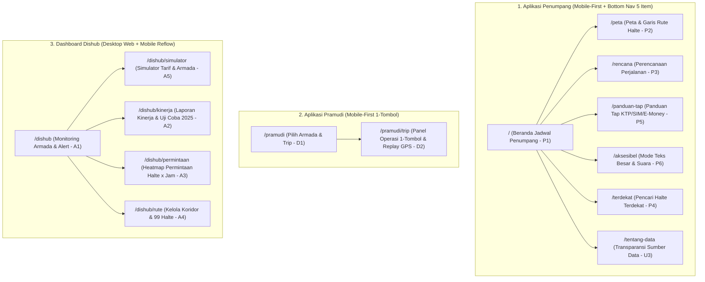

# APPFLOW.md: Peta Navigasi, Alur Pengguna, & Transisi State JAMBI JALAN

Dokumen ini memastikan seluruh tautan navigasi, tombol, dan perpindahan halaman di dalam **JAMBI JALAN** tidak memiliki jalan buntu (*no dead links / ghost routes*, patuh aturan R-24 dan R-26).

---

## 1. Peta Situs & Struktur Navigasi (Sitemap)

Aplikasi memiliki tiga pintu masuk sesuai peran pengguna, dengan penukar peran (*Role Switcher*) kecil di bagian atas/footer agar dewan juri dapat berpindah antar klien dengan satu klik:

### Aturan Navigasi Ketat (R-24)
1. **Bottom Navigation Bar Penumpang** hanya boleh berisi **5 tautan aktif** yang halamannya benar-benar ada:
   - `Jadwal` (`/`)
   - `Peta & Halte` (`/peta`)
   - `Rencana` (`/rencana`)
   - `Panduan Tap` (`/panduan-tap`)
   - `Aksesibel` (`/aksesibel`)
   *(Halaman `/terdekat` dan `/tentang-data` diakses melalui tombol aksi langsung di dalam Beranda `/` dan `/rencana`).*
2. **Header Atas Penumpang** memiliki:
   - Kiri: Identitas `JAMBI JALAN` + badge `TRANS BAHAGIA` (klik kembali ke `/`).
   - Kanan: Tombol cepat `A+ Suara` (langsung menyalakan teks besar + membacakan info trip aktif) dan tautan ringkas `Pramudi` / `Dishub` untuk kemudahan pengujian juri.
3. **Sidebar / Top Tab Dashboard Dishub** hanya berisi **5 menu aktif**:
   - `Monitoring Armada` (`/dishub`)
   - `Simulator Tarif & Armada` (`/dishub/simulator`)
   - `Laporan Kinerja` (`/dishub/kinerja`)
   - `Analisis Permintaan` (`/dishub/permintaan`)
   - `Kelola Rute & Halte` (`/dishub/rute`)

---

## 2. Empat Alur Utama Pengguna (End-to-End Flows)

### Alur 1: Penumpang Mengecek Trip Berikutnya & Membagikan ke Keluarga (`F-14`, `F-04`, `F-15`, `F-17`)
1. Penumpang membuka `/`.
2. Sistem mengecek jam aktif (jam sistem atau jam simulasi demo) dan koridor/halte yang dipilih (default: `Koridor 1`, halte `Terminal Rawasari`).
3. **Kartu Papan Keberangkatan** menampilkan:
   - Jam berangkat trip berikutnya (misal `07:00 WIB`) dan hitung mundur (`14 menit lagi`).
   - Status keyakinan posisi (`[● Posisi Langsung]` jika pramudi sedang jalan, atau `[◷ Jadwal Resmi]` jika belum berangkat).
   - Tingkat kepenuhan (`[Padat - Data Contoh]`).
4. Penumpang mengetuk lencana kepenuhan -> muncul panel penjelasan: *"Biasanya padat pada jam berangkat sekolah dan kantor (07.00). Jika waktu Anda fleksibel, disarankan naik Trip 3 pukul 08.30 WIB (Longgar)."*
5. Penumpang mengetuk tombol **`Bagikan ke WhatsApp`** (`F-17`) -> membuka `https://wa.me/?text=...` (atau menyalin teks dengan notifikasi berhasil) berisi info lengkap jadwal untuk dikirim ke orang tua/keluarga di rumah.

### Alur 2: Lansia Menggunakan Mode Aksesibel & Panduan Tap (`F-05`, `F-16`)
1. Lansia membuka `/` dan mengetuk tombol **`A+ Suara`** di pojok kanan atas (atau masuk ke tab `/aksesibel`).
2. Seketika ukuran seluruh huruf membesar 25%, garis tepi kartu menebal menjadi `2px solid #111C18`, dan peramban membacakan kalimat Bahasa Indonesia:
   *"Koridor 1, Terminal Rawasari menuju Terminal Alam Barajo via Sipin. Bus berikutnya berangkat pukul 08.30 WIB, sekitar 12 menit lagi. Perkiraan kondisi bus longgar."*
3. Lansia berpindah ke tab **`Panduan Tap`** (`/panduan-tap`), memilih **`KTP Elektronik`**, lalu melihat 3 langkah bergambar besar dan dapat menekan **`Bacakan Langkah Tap`**.

### Alur 3: Pramudi Mengirim Lokasi & Penanganan Sinyal Putus (`F-07`, `F-08`, `F-15`)
1. Pramudi membuka `/pramudi`, memilih `Bus Listrik Medium 01`, `Koridor 1 (Rawasari ke Alam Barajo via Sipin)`, dan `Trip 2 (07:00)`, lalu menekan **`Buka Panel Perjalanan`**.
2. Di halaman `/pramudi/trip`, pramudi menekan tombol raksasa **`MULAI TRIP SEKARANG`**.
3. Status berubah menjadi **`TRIP SEDANG BERJALAN`**. Koordinat dikirim setiap 10 detik melalui `BroadcastChannel` dan disimpan di `localStorage`.
4. Di tab `/` (Penumpang) dan `/dishub` (Admin), status bus langsung berubah menjadi **`[● Posisi Langsung]`** dan titik bus bergerak dari halte ke halte berikutnya, memperbarui ETA di semua halte di depannya.
5. **Skenario Gangguan (Tabel 9 Proposal):** Saat tombol **`Simulasi Sinyal Putus`** diaktifkan pada `/pramudi/trip`:
   - Layar pramudi menampilkan jumlah titik koordinat yang disimpan sementara di perangkat (`Antrean Offline: 3 titik`).
   - Setelah 20 detik tanpa sinyal baru, layar Penumpang (`/`) dan `/peta` otomatis menurunkan lencana menjadi **`[◷ Perkiraan dari Jadwal]`** disertai banner kuning jujur.
   - Saat tombol **`Pulihkan Sinyal`** ditekan, antrean koordinat terkirim dan status kembali menjadi **`[● Posisi Langsung]`**.

### Alur 4: Admin Dishub Mengevaluasi Kinerja & Menyimulasikan Tarif (`F-09` s.d. `F-13`)
1. Admin membuka `/dishub` dan melihat daftar seluruh bus, termasuk peringatan merah jika ada trip yang terlambat dimulai lebih dari 10 menit, serta saran penambahan trip pada jam sibuk yang keterisiannya melewati 80%.
2. Admin membuka **`Simulator Tarif & Armada`** (`/dishub/simulator`).
3. Kondisi awal menampilkan **Tarif Rp0 (Gratis)** dengan kalibrasi data uji coba 2025.
4. Admin menggeser slider tarif dari `Rp0` ke `Rp3.000`, lalu menambah jumlah unit dari `6 unit awal` menjadi `10 unit` (skenario +4 unit tambahan Oktober 2025).
5. Kartu hasil dan grafik perbandingan langsung memperlihatkan perubahan jarak waktu antar bus (*headway* memendek), perkiraan penumpang harian, pendapatan bulanan, serta tingkat keterisian kursi, lengkap dengan penjelasan rumus satu menit dan label **`ASUMSI SIMULASI`**.

---

## 3. Naskah Demo Panggung 90 Detik di Depan Dewan Juri

Siapkan layar laptop dengan 2 jendela berdampingan: **Jendela Kiri (Ukuran Mobile 390px)** membuka `/` dan `/pramudi`, **Jendela Kanan (Ukuran Desktop)** membuka `/dishub/simulator`.

| Detik | Aksi Presenter | Perubahan Nyata di Layar |
|---|---|---|
| **00–15** | Tunjukkan Beranda Penumpang (`/`). Ubah jam demo dari malam (`21:00`, keadaan selesai) ke pagi (`06:50`). | Keadaan kosong berubah menjadi **Kartu Papan Keberangkatan** Trip 2 (`07:00`), hitung mundur berjalan, muncul lencana `[Padat - Data Contoh]`. |
| **15–30** | Ketuk lencana `Padat` dan tombol `A+ Suara`. | Panel alasan kepenuhan terbuka + menyarankan Trip 3 (`08:30`); huruf membesar 25% dan suara Bahasa Indonesia membacakan jadwal. |
| **30–50** | Pindah ke tab `/pramudi/trip`, tekan **`MULAI TRIP SEKARANG`** + nyalakan **`Simulasi Gerak Bus`**. Lalu tekan **`Simulasi Sinyal Putus`**. | Bus bergerak di peta `/peta` dan `/dishub` dengan badge hijau `[● Posisi Langsung]`. Saat sinyal diputus, antrean offline naik dan badge penumpang otomatis turun ke kuning `[◷ Perkiraan dari Jadwal]`. |
| **50–80** | Di Jendela Kanan (`/dishub/simulator`), geser tarif dari `Rp0` ke `Rp3.000` dan ubah unit dari `6` ke `10 unit` (tambahan 4 kendaraan Oktober 2025). | Angka *headway* turun, perkiraan penumpang & pendapatan bulanan langsung terhitung dengan kalibrasi data uji coba 2025 (`~12 penumpang/trip`), didampingi banner `ASUMSI SIMULASI`. |
| **80–90** | Buka sekilas `/dishub/rute` (99 halte publik) dan `/tentang-data`. | Menutup demo dengan bukti bahwa 3 koridor & 99 halte berasal dari publikasi nyata, sementara angka simulasi diberi label jujur. |
